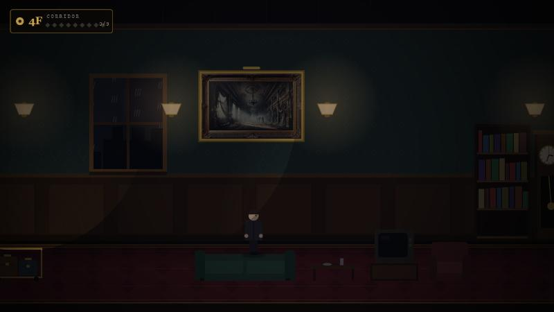

# No Way Out

*A hotel corridor that repeats. Spot what has changed, pick the right door, nine times in a row.*

You checked in on a Tuesday. You no longer remember which one. Fourth floor: the lift at one end, the fire stairs at the other. Every time you reach the end of the corridor you are back at the start, and it is never quite the same corridor.

The rule, written on the back of your key card:

> If anything has changed, go back to the **lift**.
> If nothing has changed, go on through the **stairs**.
> Nine corridors. Then you may leave.

A short psychological-horror platformer in the anomaly-hunt tradition. No dependencies, no build step, runs in any modern browser.



## Play

Online: enable GitHub Pages for this repository (Settings → Pages → Source: *GitHub Actions*) and every push to `main` deploys automatically.

Locally:

```bash
npm start
```

Then open <http://localhost:3000/>. Any static file server works too, for example `npx serve .` or `python -m http.server`. Node 18 or newer is required only for the bundled server.

## Controls

| Action | Keys |
| --- | --- |
| Walk | ← → or A D |
| Jump | ↑, W or Space |
| Use the lift / stairs | E or F |
| Pause | Esc or P |
| Menus | ↑ ↓ Enter, or the mouse |

## How it plays

- **Corridor 0 is always clean.** Walk it and remember everything: the room numbers, the lamps, the paintings, the furniture, the sounds.
- From then on each corridor has roughly a 60 % chance of containing one anomaly from a pool of 34. Early corridors draw from the obvious ones, later corridors from the subtle ones, and nothing repeats within a run.
- **Lift** if something changed, **stairs** if nothing did. A correct choice counts a corridor. A wrong one resets you to zero and tells you what you missed.
- Some anomalies are lethal: a shade that comes out of the stairwell, a flood that takes the corridor from the far end. If something is coming for you, run back to the lift.
- Nine in a row and you check out. Your best run is saved in the browser.

### Anomaly pool

Subtle: wrong room number, number from another floor, crooked painting, two dark lamps, stopped clock, dead plant, carpet stain, red exit sign, mirrored exit sign, exit arrow pointing back, extra books, red vending machine, moon instead of rain, moved bench, extra armchair, lift on the wrong floor, footsteps that keep going after you stop.

Noticeable: swapped painting, upside-down painting, flickering lights, clock running backwards, an extra door, a door ajar with the light on, knocking from inside a room, handprints on the wall, empty mirror, something else in the mirror, television on, ringing payphone, ceiling drip, a doll on the bench that watches you.

Obvious or lethal: blackout, a figure waiting at the stairs, the shade, the flood.

## Project layout

```
index.html            entry point
server.js             tiny static server for local play (node server.js)
src/
  main.js             boot, canvas scaling, frame loop, scene switching
  config.js           logical size, palette, physics, loop count
  world.js            the baseline corridor (doors, lamps, paintings, furniture)
  anomalies.js        the anomaly pool and the per-corridor picker
  entities.js         shade, flood, figure, ceiling drip
  player.js           movement, jumping, collisions
  audio.js            Web Audio: short samples + synthesised ambience/effects
  input.js            keyboard and mouse mapped to actions
  save.js             localStorage (volume, best run)
  ui.js               text, menus, fades, key caps
  render/
    corridor.js       background, layers, lighting pass
    props.js          every drawable fixture and piece of furniture
    character.js      the guest and the shade
  scenes/
    title.js intro.js play.js ending.js
assets/
  images/             title art, paintings, handprint
  sounds/             ambience, menu, jump, door, death
```

Design notes:

- The world is **data**. An anomaly only mutates the world object (`doors[3].number = 406`, `tv.static = true`); renderers never know which anomaly is active. Adding one is a few lines in `anomalies.js`.
- Everything is drawn procedurally on a 1280×720 logical canvas, scaled to the window. A lighting pass punches holes in a dark overlay for each lamp, so a dead lamp or a blackout is a real change in what you can see.
- Rain, hum, static, water, knocks, footsteps, the lift chime and the heartbeat are synthesised with the Web Audio API. The five remaining samples total about 6 MB (the original project shipped 150 MB of audio).
- A run is seeded, so a sequence of corridors can be reproduced.

Debug helpers (query parameters): `?skip` jumps straight into the corridor, `?anomaly=<id>` forces one (`?anomaly=none` for a clean corridor), `?nolight` disables the lighting pass. In the console, `__game.scene.player.x = 5300` teleports.

## Checks

```bash
npm run check
```

Parses every module and the server. The GitHub Pages workflow runs it before deploying.

## History

Started as a university project built on p5.js (see the git history before the `production-redesign` branch). This version is a rewrite: same premise, same assets where they fit the story, new engine, new corridor, new anomaly system, and an ending.

## License

MIT for the code. The title art and paintings were generated for the original project.
